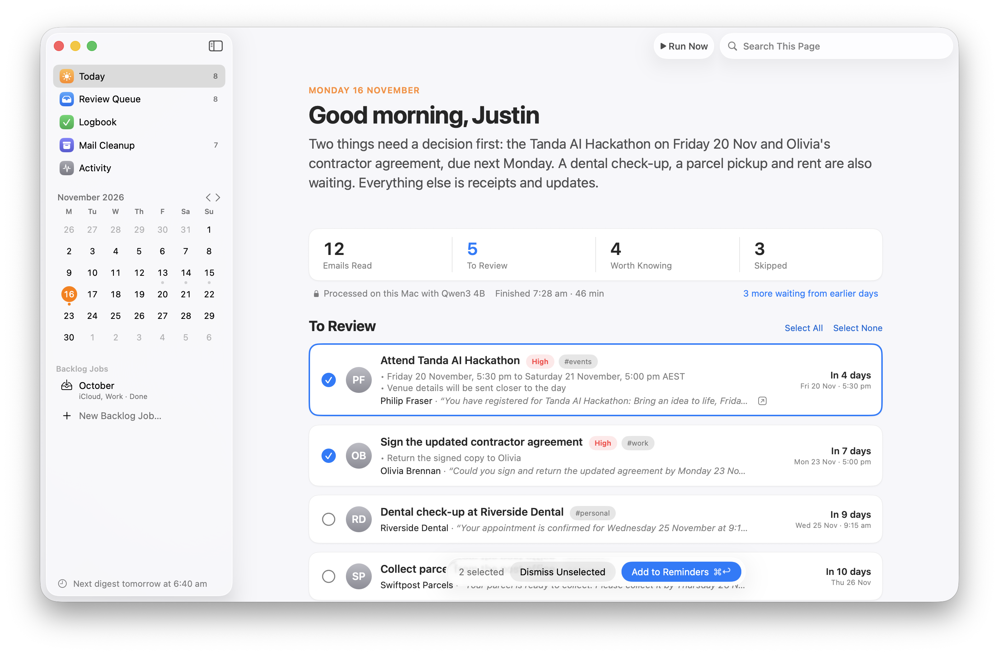
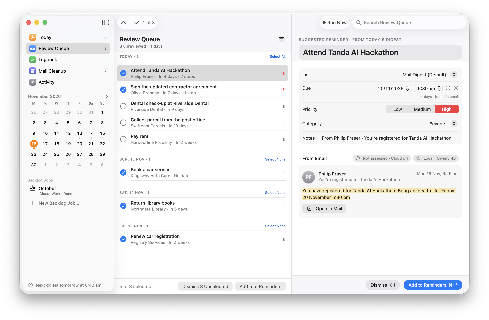
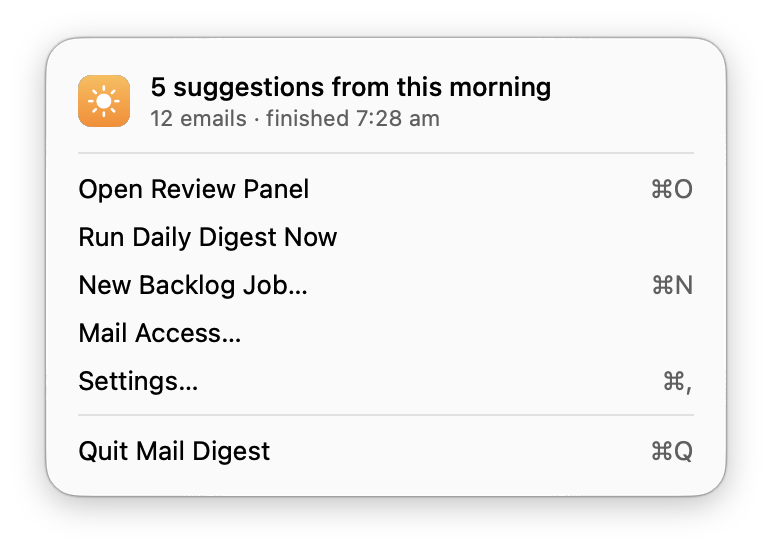
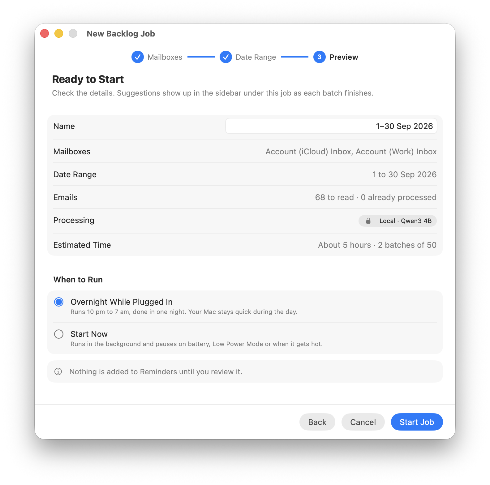
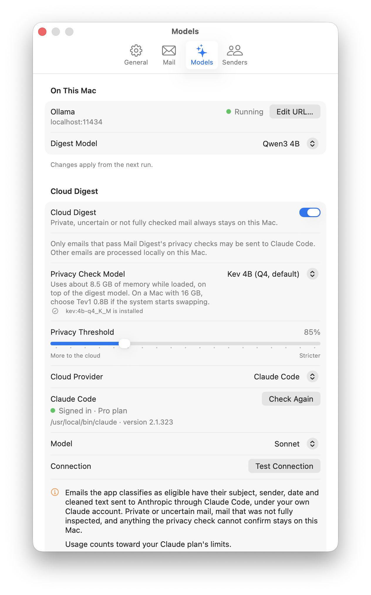

# Mail Digest

A privacy-first morning digest for Apple Mail. Mail Digest is a native macOS menu bar app that reads your new mail overnight, uses a local language model to summarise it and suggest reminders, and lets you decide what goes into Apple Reminders.

<picture>
  <source media="(prefers-color-scheme: dark)" srcset="docs/images/today-dark.png">
  
</picture>

## Why Mail Digest?

Inboxes fill up faster than most of us can read them, and the email that matters (a deadline, an invitation) is easy to miss among newsletters and notifications. There are plenty of ways to automate this today: connect an AI agent to your mailbox, or switch to a mail service with built-in summaries. Most of them route your mail through someone else's servers.

I wanted something that respects privacy without giving up convenience. Mail Digest works with the Mail.app you already use, does its thinking on your Mac with [Ollama](https://ollama.com), and nothing changes in Reminders until you approve it.

## Features

- **Morning digest.** A scheduled run (6:30 am by default) processes new mail in the background and notifies you when suggestions are ready. You can also run it on demand from the menu bar.
- **Suggested reminders, with evidence.** Each suggestion quotes the sentence it came from, so you can check it against the email before approving. Edit the title, date or priority, then add the ones you want to Apple Reminders. They sync to your iPhone through iCloud.
- **Worth-knowing summaries.** Emails that need no action get a short summary you can skim, pin or save to Notes.
- **Backlog jobs.** Work through thousands of older messages in batches. Jobs pause and resume, and can run overnight while your Mac is plugged in.
- **Learns from your decisions.** Dismissals feed sender rules, so the noise drops off over time.
- **Optional cleanup.** Move processed mail to Trash or a folder of your choice, only after you approve it.
- **Optional Cloud Digest.** Speed up processing by sending clearly public mail (newsletters, job alerts) to a cloud model you already use. See [Privacy](#privacy) for how that decision is made.

<details>
<summary>More screenshots</summary>

| Review Queue | Menu bar |
| --- | --- |
|  |  |

| New Backlog Job | Settings › Models |
| --- | --- |
|  |  |

</details>

## Requirements

- macOS 15 Sequoia or later. Built and tested on an Intel Mac; Apple silicon should work but isn't verified yet (see [Roadmap](#roadmap)).
- [Ollama](https://ollama.com) 0.40.4 or later, running locally.
- Mail.app, set up with your accounts.
- About 4 GB of free memory for the default model, and more if you turn on Cloud Digest's privacy check.

## Getting started

### 1. Install Ollama

Mail Digest doesn't bundle a model. It talks to Ollama on your Mac, so **install Ollama first**:

1. Download it from [ollama.com/download](https://ollama.com/download) and open it once, so it keeps running in the menu bar.
2. Optionally pull the default model ahead of time:

   ```sh
   ollama pull qwen3:4b
   ```

If you skip this step, the setup screen notices and walks you through it: it can open the download page, start Ollama and download the model for you.

### 2. Install Mail Digest

Download the latest `.dmg` from [Releases](../../releases), open it and drag **MailDigest** into your Applications folder.

Mail Digest is not yet notarized by Apple, so macOS will refuse to open it the first time:

1. Open Mail Digest. When macOS says it can't verify the developer, click **Done**.
2. Open **System Settings › Privacy & Security**, scroll down to the message about Mail Digest and click **Open Anyway**.
3. Confirm with your password or Touch ID.

You only need to do this once per version. Prefer the Terminal? This removes the quarantine flag instead:

```sh
xattr -dr com.apple.quarantine /Applications/MailDigest.app
```

If you'd rather not run a binary you didn't build, see [Building from source](#building-from-source).

### 3. Grant permissions

On first launch Mail Digest explains each permission it needs and links to the right pane in System Settings:

| Permission | Why |
| --- | --- |
| Full Disk Access (recommended) | Fast, read-only access to Mail's local database and message files |
| Automation › Mail | Fallback for reading messages, and asking Mail to check for new mail |
| Reminders | Adding the suggestions you approve |
| Notifications | Telling you when the morning digest is ready |

Without Full Disk Access the app still works through Mail's scripting interface, only more slowly. Mail Digest never sends, replies to or deletes email on its own.

## Privacy

By default, **every email is processed on your Mac** by Qwen3 4B through Ollama. Nothing is uploaded.

Cloud Digest is off until you turn it on and accept a disclosure. It exists because local inference on an Intel Mac is slow: a long email can take minutes on the CPU. That's fine overnight while you sleep, but it adds up on a busy morning. When Cloud Digest is on, each email goes through two checks before it can leave your Mac:

1. **Deterministic rules** look for strong private signals (account numbers, health and financial details, government and bank senders, personal replies). Any hit keeps the email local.
2. **A local System One model** reads the whole message and scores how likely it is to be private. If you've seen TypeSafe's [Jev](https://typesafe.ai/blog/introducing-system-one-models-and-jev), it's the same idea: a model that returns a calibrated decision instead of free text. The difference is that this one runs on your Mac through Ollama (Kev by default, or the smaller Tev), so the email is never uploaded just to decide whether it can be uploaded. Only email that scores as confidently public and non-sensitive is eligible.

Eligible email goes to the provider you choose: **Claude Code** using your existing Claude subscription, or **Gemini** with your own API key (stored in the Keychain). Anything uncertain, incompletely inspected or failing stays local, and a cloud error falls back to the local model. Every digest records which route each email took and why.

## Building from source

You'll need Xcode 26.6 or later.

```sh
git clone https://github.com/jstvn/mail-digest.git
cd mail-digest
open MailDigestApp/MailDigest.xcodeproj
```

In the **MailDigest** target's *Signing & Capabilities*, choose your own team and change the bundle identifier, then build and run. macOS ties Full Disk Access and Automation grants to the app's signature, so a stable signing identity saves you re-granting them after every build.

All logic that doesn't need an Apple framework lives in the `MailDigestCore` Swift package, which builds and tests on both macOS and Linux:

```sh
cd Packages/MailDigestCore
swift build
swift test
```

The full product and implementation spec is in [`docs/SPEC.md`](docs/SPEC.md), and design decisions are recorded in [`docs/QUESTIONS.md`](docs/QUESTIONS.md).

## Roadmap

- **January 2027: Apple silicon, properly.** Mail Digest was built and tuned on a 2019 Intel MacBook Pro. Support for [Apple Foundation Models](https://developer.apple.com/documentation/foundationmodels) and MLX builds of open models is already in the code, but untested on real hardware. The plan is to verify both, tune the defaults per chip and make local processing fast enough that Cloud Digest becomes truly optional. (That's when I'm planning to buy a new MacBook.)
- **More cloud providers.** Support for services such as ChatGPT alongside Claude Code and Gemini, behind the same privacy check.

## Acknowledgements

Mail Digest stands on the work of these projects:

- [Ollama](https://github.com/ollama/ollama) for local model serving
- [Qwen3](https://github.com/QwenLM/Qwen3) by the Qwen team, the default local model
- Kev and Tev, the System One models behind the privacy check
- [GRDB.swift](https://github.com/groue/GRDB.swift) for the local SQLite store
- [SwiftSoup](https://github.com/scinfu/SwiftSoup) for turning HTML mail into plain text
- [che-apple-mail-mcp](https://github.com/PsychQuant/che-apple-mail-mcp), whose research into Apple Mail's local store and `.emlx` format guided the fast read path

## License

Mail Digest is free software, released under the [GNU General Public License v3.0](LICENSE). You're welcome to use, study, modify and share it; if you distribute a modified version, it must be released under the same license.
